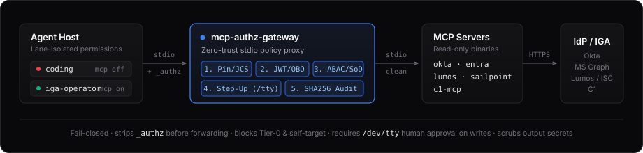

# identity-mcp

[](https://github.com/rlwillen0121/identity-mcp/actions/workflows/test.yml)
[](go.mod)
[](LICENSE)
[](https://m8ven.ai/mcp/rlwillen0121/identity-mcp)

Five read-only [MCP](https://modelcontextprotocol.io) servers that let a coding agent answer identity-governance questions — who can reach which app, which accounts went stale, who holds privileged access — without giving it any way to change them, plus a companion zero-trust authorization proxy (`mcp-authz-gateway`).

| Binary | API / Role | Covers |
| --- | --- | --- |
| `okta-mcp` | Okta Management API | Users, groups, apps, admins, System Log |
| `entra-mcp` | Microsoft Graph | Users, groups, directory roles, service principals, sign-ins |
| `lumos-mcp` | Lumos REST (`api.lumos.com`) | Users, app accounts, groups, access reviews, activity logs |
| `sailpoint-mcp` | SailPoint ISC **v2026** | Identities, accounts, entitlements, sources, search, account activities |
| `c1-mcp` | ConductorOne API (`/api/v1`) | Users, app accounts, entitlements, access reviews, tasks |
| `mcp-authz-gateway` | Stdio MCP Authorization Proxy | Binary/schema pinning, offline JWT/OBO authz, Tier-0/SoD rules, human step-up (`approve`), hash-chained audit ledger |

> [!IMPORTANT]
> Every tool in `okta-mcp`, `entra-mcp`, `lumos-mcp`, `sailpoint-mcp`, and `c1-mcp` is a read. There are no create, update, or delete paths in those five servers, they never ask for write scopes, and tokens come from the environment and are never logged. See [SECURITY.md](SECURITY.md) and [`SPEC-mcp-authz-gateway.md`](SPEC-mcp-authz-gateway.md).



## Quickstart

Install the binaries — requires **Go 1.26+**, no other runtime dependencies:

```bash
go install github.com/rlwillen0121/identity-mcp/cmd/okta-mcp@latest
go install github.com/rlwillen0121/identity-mcp/cmd/entra-mcp@latest
go install github.com/rlwillen0121/identity-mcp/cmd/lumos-mcp@latest
go install github.com/rlwillen0121/identity-mcp/cmd/sailpoint-mcp@latest
go install github.com/rlwillen0121/identity-mcp/cmd/c1-mcp@latest
go install github.com/rlwillen0121/identity-mcp/cmd/mcp-authz-gateway@latest
```

Export credentials for the provider you use. For example, an Okta setup is:

```bash
export OKTA_ORG_URL="https://your-org.okta.com"
export OKTA_API_TOKEN="…"        # Admin → Security → API → Tokens
```

The other servers use the variables documented in [Configuration](#configuration): Entra ID uses client credentials, while Lumos, SailPoint ISC, and ConductorOne use their respective read-only credentials.

Point your agent at the server. For OpenCode, in `opencode.json`:

```json
{
  "$schema": "https://opencode.ai/config.json",
  "mcp": {
    "okta": {
      "type": "local",
      "command": ["okta-mcp"],
      "enabled": true,
      "timeout": 15000,
      "environment": {
        "OKTA_ORG_URL": "{env:OKTA_ORG_URL}",
        "OKTA_API_TOKEN": "{env:OKTA_API_TOKEN}"
      }
    }
  }
}
```

Then ask for something you would otherwise click through four admin screens to get:

> Which Okta admins haven't signed in for 90 days?

The agent calls `list_admins`, follows up with `find_stale_users`, and answers from structured JSON — no scraping, no write access, no console.

> [!TIP]
> Binaries must be on `PATH`. If they are not, use an absolute path in `command` — `$(go env GOPATH)/bin/okta-mcp`.

## Tools

Deliberately small sets. Every tool a host loads costs context on every turn, so these cover the questions that actually come up in access reviews rather than wrapping the whole API.

**`okta-mcp`**

| Tool | Use when |
| --- | --- |
| `list_users` | Search the directory (`search` / `filter`, page with `after`) |
| `get_user` | You already have an id or login |
| `list_user_groups` | Groups for one user |
| `list_groups` | Find a group by name |
| `list_group_users` | Members of a group |
| `list_apps` | Find an SSO app |
| `list_app_users` | Who is assigned to an app |
| `list_admins` | Privileged-access review (IAM assignees) |
| `find_stale_users` | Never logged in, dormant past N days, or provisioning expired |
| `list_logs` | System Log (cap 100) |

**`entra-mcp`**

| Tool | Use when |
| --- | --- |
| `list_users` | Search/page users (`$search` / `$filter`) |
| `get_user` | Profile plus up to 50 `memberOf` groups |
| `list_user_groups` | Groups for one user |
| `list_groups` | Find groups |
| `list_group_members` | Members (user / group / servicePrincipal) |
| `list_directory_roles` | Activated directory roles |
| `list_role_members` | Who holds a directory role |
| `list_service_principals` | Non-human identities and enterprise apps |
| `find_stale_users` | Disabled, never signed in, or last sign-in past N days |
| `list_sign_ins` | Audit sign-in rows (cap 50) |

**`lumos-mcp`**

| Tool | Use when |
| --- | --- |
| `list_users` | Find people in Lumos (`search_term`, integer `page` cursor) |
| `get_user` | You already have a Lumos user id |
| `get_user_access` | What this person has: profile, Lumos roles, app accounts (cap 50) |
| `list_apps` | Apps Lumos knows about |
| `list_app_accounts` | Who has an account on an app |
| `list_groups` | Groups synced from connected integrations |
| `list_group_members` | Members of a Lumos group |
| `find_stale_accounts` | Suspended/archived/deprovisioned, never used, or last login past N days |
| `list_access_reviews` | Open or recent access-review campaigns |
| `list_activity_logs` | Who requested, approved, or provisioned access (cap 100) |

**`sailpoint-mcp`**

| Tool | Use when |
| --- | --- |
| `list_identities` | Find ISC identities (`filters`, `defaultFilter=CORRELATED_ONLY`) |
| `get_identity` | You already have an identity id |
| `get_identity_access` | What this identity has across sources: accounts, entitlements, roles (cap 50 each) |
| `list_accounts` | Accounts by a raw ISC `filters` string (`detailLevel=SLIM`) |
| `list_uncorrelated_accounts` | Accounts not correlated to an identity |
| `list_sources` | Connected sources |
| `search` | First-class ISC search (`POST /search`, cap 50) |
| `find_stale_identities` | Inactive lifecycle/state plus a bounded uncorrelated-account sample |
| `list_account_activities` | Provisioning / access-request evidence (cap 100). A least-privilege PAT gets 403; use `search` with the `accountactivities` index instead |
| `list_entitlements` | Find an entitlement before asking who has it |

**`c1-mcp`**

| Tool | Use when |
| --- | --- |
| `list_users` | Find ConductorOne users (`query`, `email`, `user_status`, `role_id`) |
| `get_user` | You already have a user id; includes `role_ids` and best-effort `role_names` |
| `get_user_access` | What this person has: slim user, app accounts, and grants (cap 50 each) |
| `list_apps` | Apps ConductorOne knows about |
| `list_app_users` | Accounts on one app (`status`, `type`) |
| `list_entitlements` | Entitlements, optionally for one app |
| `list_uncorrelated_accounts` | App accounts with no responsible party |
| `find_stale_accounts` | Disabled, deleted, never used, or last usage past N days (scans at most 500) |
| `list_access_reviews` | Access-review campaigns |
| `list_tasks` | Open or closed tasks (cap 10); read-only, no task actions |

## Configuration

### Okta

| Variable | Meaning |
| --- | --- |
| `OKTA_ORG_URL` | `https://your-org.okta.com` |
| `OKTA_API_TOKEN` | SSWS API token (Admin → Security → API → Tokens) |

The token needs read on users, groups, apps, and logs. `list_admins` additionally needs an admin token with IAM role read — `okta.roles.read` if you use OAuth rather than SSWS.

### Entra ID

Register an app, use **client credentials**, and grant these Microsoft Graph *application* permissions with admin consent:

- `Directory.Read.All` — users, groups, roles, service principals
- `AuditLog.Read.All` — sign-in logs and `signInActivity` (needed for stale users)

| Variable | Meaning |
| --- | --- |
| `AZURE_TENANT_ID` | Tenant GUID |
| `AZURE_CLIENT_ID` | App (client) id |
| `AZURE_CLIENT_SECRET` | Client secret |
| `GRAPH_BASE_URL` | Optional, defaults to `https://graph.microsoft.com/v1.0` |

> [!NOTE]
> If your tenant rejects `signInActivity` — it needs the right license and returns 400 without it — `list_users` and `get_user` automatically retry without that field rather than failing.

### Lumos

Create an API token in Lumos (Settings → API Tokens). Tokens are prefixed `lsk_` and inherit the creating user's role.

| Variable | Meaning |
| --- | --- |
| `LUMOS_API_TOKEN` | Bearer token (`lsk_…`) |
| `LUMOS_BASE_URL` | Optional, https. Defaults to `https://api.lumos.com` |

### SailPoint Identity Security Cloud

Use a **personal access token**. `GET /identities` is `userAuth` / `idn:identity:read` — API-management clients without user context 403. Least-privilege scopes:

- `idn:identity:read`
- `idn:accounts:read`
- `idn:sources:read`
- `idn:entitlement:read`
- `sp:search:read`

A PAT with only `idn:identity:read`, `idn:accounts:read`, `idn:sources:read`, `idn:entitlement:read`, and `sp:search:read` gets 403 from `list_account_activities`. Use the `search` tool with the `accountactivities` index instead.

Do not grant `sp:scopes:all`.

| Variable | Meaning |
| --- | --- |
| `SAILPOINT_TENANT` | Required unless both `SAILPOINT_BASE_URL` and `SAILPOINT_TOKEN_URL` are set (`acme` → `https://acme.api.identitynow.com`) |
| `SAILPOINT_CLIENT_ID` | PAT id |
| `SAILPOINT_CLIENT_SECRET` | PAT secret |
| `SAILPOINT_BASE_URL` | Optional https override. Default `https://{tenant}.api.identitynow.com/v2026` |
| `SAILPOINT_TOKEN_URL` | Optional. Default `https://{tenant}.api.identitynow.com/oauth/token` |

The token URL is unversioned (`/oauth/token`). Resource calls are under `/v2026`.

### ConductorOne

Use a **Read-Only Administrator** credential. Do not grant Full Permissions.

The client id looks like `<random>@<hostname>/<use>`. The hostname in that id is parsed to build the API and token URLs. EU tenants already have `c1eu.ai` in the hostname, so the defaults are `https://<hostname>/api/v1` and `https://<hostname>/auth/v1/token`. Set `C1_BASE_URL` or `C1_TOKEN_URL` only to override; explicit https URLs win.

Client credentials are posted as a form body (`client_id`, `client_secret`, `grant_type=client_credentials`), not HTTP Basic.

| Variable | Meaning |
| --- | --- |
| `C1_CLIENT_ID` | Client id (`<random>@<hostname>/<use>`) |
| `C1_CLIENT_SECRET` | Client secret |
| `C1_BASE_URL` | Optional https API root, including `/api/v1` |
| `C1_TOKEN_URL` | Optional https token URL |

## Keeping credentials away from coding agents

An agent that can edit your repo should not also hold a live directory or IGA token. The two jobs run in separate lanes, enforced by host permissions rather than by asking the model nicely:

| Agent | Kind | May edit source | May call Okta/Entra/Lumos/SailPoint/C1 |
| --- | --- | --- | --- |
| `orchestrate` | primary | no | no |
| `implement` | subagent | yes | no |
| `review` | subagent | no | no |
| `iga-operator` | primary | no | **yes** |

Contributor agents get the MCP servers switched **off**; only `iga-operator` gets them on. Tab to `iga-operator` for directory and IGA work and back for code. Full rules in [AGENTS.md](AGENTS.md).

### Companion Authorization Proxy (`mcp-authz-gateway`)

For environments that require cryptographic principal attribution, manifest/binary pinning, OBO scope intersection, Separation of Duties (SoD), offline Ed25519 human step-up approval (`approve`), and a hash-chained audit ledger (`verify-audit`), wrap any stdio MCP server behind `mcp-authz-gateway`:

- **Normative specification:** [`SPEC-mcp-authz-gateway.md`](SPEC-mcp-authz-gateway.md)
- **Example policies:** [`examples/authz/okta-read-policy.json`](examples/authz/okta-read-policy.json) (`mode_a_readonly_local`) and [`examples/authz/okta-write-policy.json`](examples/authz/okta-write-policy.json) (`mode_b_uid_boundary`)

```bash
# 1. Initialize state.db, state.db.lock, and genesis-anchored audit.jsonl
mcp-authz-gateway init-state --policy /abs/path/to/policy.json

# 2. Verify upstream binary and pin canonical RFC 8785 JCS tool schemas to mcp-authz.lock.json
mcp-authz-gateway pin --policy /abs/path/to/policy.json

# 3. Point your MCP host at the gateway instead of the raw upstream binary
mcp-authz-gateway serve --policy /abs/path/to/policy.json
```

#### 5-Stage Fail-Closed Evaluation Pipeline

When `mcp-authz-gateway serve --policy /abs/path/to/policy.json` intercepts a `tools/call` request, it strips the reserved `_authz` envelope (`principal_jwt`, `obo_token`, `approval_token`, `justification`, `ticket_id`) before the upstream server sees the arguments and enforces:

1. **Stage 1 — Manifest & Schema Gate:** Verifies the tool against `mcp-authz.lock.json` (and re-verifies on any upstream `notifications/tools/list_changed` signal), enforces strict JSON decoding (no duplicate keys, no ASCII case-colliding keys, IEEE-754 `int53` integer bounds, no C0/C1/Bidi control characters), and validates arguments against the pinned `inputSchema`.
2. **Stage 2 — Principal Identity (`principal_jwt`):** Verifies the caller's offline JWS (`EdDSA`, `ES256`, or `RS256`), validates `iss`, `aud`, `exp`, `nbf`, `iat`, `max_token_age_seconds`, rejects Entra group-overage pointers (`_claim_names`), and checks `state.db` revocations.
3. **Stage 3 — OBO Scope Intersection & Argument Constraints:** Computes `EffectiveScopes = AgentAllowedScopes ∩ PrincipalScopes ∩ OBOScopes`, verifies `tool.required_scopes`, and enforces `arg_constraints` (`required_non_empty`, `numeric_bounds`, `enum_allowlist`, `limit_arg_bindings`, `array_cap_bindings` including `[*]` wildcard array paths).
4. **Stage 4 — Target ABAC, Tier-0 Denylist, Self-Target & Permanent SoD:** Extracts and normalizes target arguments (`email`, `id_alnum`, `lower_trim`), blocks Tier-0 protected users/groups/apps/roles/entitlements (`PROTECTED_RESOURCE_DENIED`), prevents self-modification (`SELF_TARGET_FORBIDDEN`), checks `subject_target_bindings` and `abac_rules`, and enforces permanent Separation of Duties (`sod_rules`) across static entitlements and `state.db` grants (`SOD_VIOLATION_DENIED`).
5. **Stage 5 — Human Step-Up Approval & Atomic Ledger Commit:** For `write:high-risk` / `destructive` (or `write:low-risk` with `require_step_up: true`), verifies `_authz.approval_token` (bound to `intent_sha256` and `ticket_id` with cross-claim Maker-Checker anti-self-approval), acquires an exclusive `flock` on `state.db.lock`, consumes the single-use `jti`, charges the principal's write rate-limit budget, records any SoD grant, and appends a SHA-256 hash-chained `AuditRecordV1` to `audit.jsonl` before calling the upstream tool. Post-forward, responses are checked against `max_output_bytes`, `OutputSchema`, resource-exfiltration rules, and `SecretScanner`.

#### CLI Subcommands

| Subcommand | Purpose | Example |
| --- | --- | --- |
| `init-state` | Initialize `state.db`, `state.db.lock`, genesis-anchored `audit.jsonl`, `challenge_dir`, and `empty_home_dir` (`0700` / `0600`) | `mcp-authz-gateway init-state --policy /abs/path/to/policy.json` |
| `pin` | Verify upstream ELF/Mach-O binary (`O_NOFOLLOW`), spawn via `/dev/fd/%d`, canonicalize `tools/list` via RFC 8785 JCS, and write `mcp-authz.lock.json` | `mcp-authz-gateway pin --policy /abs/path/to/policy.json` |
| `serve` (`run`) | Run the stdio MCP authorization proxy | `mcp-authz-gateway serve --policy /abs/path/to/policy.json` |
| `approve` | Recompute `intent_sha256` from challenge receipt, display ASCII-sanitized diff on `/dev/tty`, and sign a single-use Ed25519 approval token | `mcp-authz-gateway approve --policy /abs/path/to/policy.json --intent-file /abs/path/to/challenge.json --approver-sub secops-lead@example.com --signing-key-file /abs/path/to/approver.key --ttl 180s --ticket INC-48291` |
| `verify-audit` | Verify every `audit.jsonl` record's JCS SHA-256 hash chain from genesis through `state.db`'s `audit_hwm` | `mcp-authz-gateway verify-audit --policy /abs/path/to/policy.json` |
| `repair` (`repair-ledger`) | Truncate a single crash-torn final line in `state.db` / `audit.jsonl` and reconcile `audit_hwm` by at most 1 record | `mcp-authz-gateway repair --policy /abs/path/to/policy.json` |
| `revoke-grant` (`revoke`) | Revoke a recorded SoD grant in `state.db` and append a `sod_grant_revoked` audit record | `mcp-authz-gateway revoke-grant --policy /abs/path/to/policy.json --subject 00u000000000000bob01 --entitlement 00g0000000apapprover --operator secops-lead@example.com --ticket INC-48291` |

## Host setup

Copy the example matching your host. The examples enable all five provider servers, so disable or remove providers you have not configured; each binary requires its provider-specific environment variables at startup. Secrets are passed by environment reference — never paste a token into these files.

<details>
<summary><b>OpenCode</b> — <code>opencode.json</code></summary>

Start from [`examples/opencode.json`](examples/opencode.json). The repo-root [`opencode.json`](opencode.json) is a working copy that also wires up the lane split above using the schema's `agent` and `permission` keys.

</details>

<details>
<summary><b>Claude Code</b> — <code>.mcp.json</code>, <code>.claude/</code></summary>

Copy [`examples/claude.mcp.json`](examples/claude.mcp.json) to `.mcp.json`, [`examples/claude.settings.json`](examples/claude.settings.json) to `.claude/settings.json`, and [`examples/claude.agents/`](examples/claude.agents/) to `.claude/agents/`.

</details>

<details>
<summary><b>Codex</b> — <code>~/.codex/config.toml</code></summary>

Merge [`examples/codex.config.toml`](examples/codex.config.toml) into `~/.codex/config.toml`. Codex does not gate MCP servers per agent, so keep the identity tools out of coding sessions by convention.

</details>

## Design notes

- **Transport** is stdio. Logs go to stderr; stdout is the MCP wire and is never printed to.
- **Annotations** — every tool is marked `readOnlyHint`, `destructiveHint` (`false`), `idempotentHint`, and `openWorldHint`, so hosts can reason about safety without special-casing.
- **Pagination** — Okta uses `after` cursors parsed from `Link: rel=next`; Graph uses `$skiptoken` from `@odata.nextLink`; Lumos list endpoints use 1-based `page`/`size` (size max 100), while `list_activity_logs` uses `limit`/`offset` and `next` is the next offset (never follow `links.next` URLs); SailPoint uses `limit`/`offset` (next is the next offset; search sends `sort: ["id"]` with limit/offset); ConductorOne search and access reviews use an opaque `page_token`, and `next` is `nextPageToken` (not an integer cursor). Cursors are opaque: absolute URLs are rejected rather than followed.
- **Page sizes** default to 50 and cap at 200, with tighter caps on logs (100), Lumos size (100), SailPoint search (50), and Entra sign-ins (50). ConductorOne sends `pageSize` 10 when the caller asks under 10, 100 when over 100, and 50 by default; `list_tasks` sends at most 10.
- **No vendor SDKs** — just `net/http` and the official [`go-sdk`](https://github.com/modelcontextprotocol/go-sdk), which keeps the dependency surface small and the failure modes visible. Lumos hosted MCP, `github.com/sailpoint-oss/golang-sdk`, ConductorOne hosted MCP, and `conductorone-sdk-go` are out of scope.
- **Composed tools** — `get_user_access`, `get_identity_access`, and Okta `list_admins` call several upstream reads and return one slim object. ConductorOne `get_user_access` is the user, one app-user search, and one grants search.

## Repository Layout

```text
identity-mcp/
├── cmd/
│   ├── okta-mcp/                  # Okta Management API read-only stdio MCP server
│   ├── entra-mcp/                 # Microsoft Graph read-only stdio MCP server
│   ├── lumos-mcp/                 # Lumos REST API read-only stdio MCP server
│   ├── sailpoint-mcp/             # SailPoint ISC v2026 read-only stdio MCP server
│   ├── c1-mcp/                    # ConductorOne API v1 read-only stdio MCP server
│   └── mcp-authz-gateway/         # Zero-trust stdio MCP authorization proxy & CLI
├── internal/
│   ├── idmcp/                     # Shared HTTP client (no-redirect, secret scrubbing), paging & MCP helpers
│   ├── okta/                      # Okta tools, types & httptest suite
│   ├── entra/                     # Entra ID / Graph tools, OAuth token cache & httptest suite
│   ├── lumos/                     # Lumos tools, types & httptest suite
│   ├── sailpoint/                 # SailPoint ISC v2026 tools, OAuth token cache & httptest suite
│   ├── c1/                        # ConductorOne tools, OAuth token cache & httptest suite
│   └── authz/                     # mcp-authz-gateway core engine
│       ├── proxy.go               # 5-stage EvaluateToolCall pipeline, epoch verification & output sanitization
│       ├── policy.go              # Policy loader, path selectors, normalizers, Tier-0/ABAC/SoD & JSON Schema
│       ├── jwt.go                 # Offline EdDSA/ES256/RS256 JWS verifier & Entra overage protection
│       ├── obo.go                 # On-Behalf-Of (OBO) token verification & scope intersection
│       ├── stepup.go              # IntentPayloadV1, Maker-Checker verification & /dev/tty approve CLI
│       ├── statedb.go             # flock-synchronized state.db ledger, jti replay cache, budgets & SoD grants
│       ├── audit.go               # Genesis-anchored SHA-256 audit.jsonl hash chain, verify-audit & SecretScanner
│       ├── pin.go                 # ELF/Mach-O binary verification & RFC 8785 JCS manifest lockfile pinning
│       ├── tcb.go                 # O_NOFOLLOW + local FS verification, UID isolation modes & child env scrubbing
│       ├── fs_darwin.go           # macOS MNT_LOCAL fstatfs & /dev/fd/%d verification
│       ├── fs_linux.go            # Linux f_type network FS denylist & /proc/self/fd/%d verification
│       ├── jcs.go                 # Strict JSON decoder (int53, case-collision, C0/C1/Bidi) & RFC 8785 JCS
│       ├── errors.go              # Deterministic ErrorCode constants & RejectionReceiptV1
│       └── authz_test.go          # End-to-end verification & security regression test suites
├── examples/
│   ├── authz/
│   │   ├── okta-read-policy.json  # Mode A (mode_a_readonly_local) policy wrapping okta-mcp
│   │   └── okta-write-policy.json # Mode B (mode_b_uid_boundary) policy with SoD & step-up approval
│   ├── opencode.json              # OpenCode MCP & agent lane configuration
│   ├── claude.mcp.json            # Claude Code .mcp.json configuration
│   ├── claude.settings.json       # Claude Code lane permission settings
│   ├── claude.agents/             # Claude Code subagent definitions (orchestrate, implement, review, iga-operator)
│   └── codex.config.toml          # Codex MCP configuration
├── .opencode/agents/              # OpenCode contributor, operator & 5 hidden blind review lanes
├── .claude/skills/iga-operator/   # Claude Code IGA operator skill (SKILL.md)
├── docs/
│   └── architecture.svg           # Architecture diagram embedded in README.md
├── SPEC-mcp-authz-gateway.md      # Normative engineering specification for mcp-authz-gateway
├── CONTRACT.md                    # Module & internal API contract
├── SECURITY.md                    # Credential, TCB & hardening posture
├── AGENTS.md                      # Contributor vs. IGA operator lane rules
└── CLAUDE.md                      # Claude Code lane mirror
```

## Development

```bash
go test ./...
```

HTTP is mocked with `httptest`; the suite makes no live Okta, Graph, Lumos, ISC, or ConductorOne calls.

## Security

These are local stdio processes that hold directory and IGA tokens in memory. Use least-privilege read-only credentials, keep secrets in the environment, and do not expose the binaries as remote MCP without putting your own authentication in front. [SECURITY.md](SECURITY.md) covers the full posture and how to report a vulnerability.

## Contributing

[CONTRACT.md](CONTRACT.md) defines the module contract — shared `internal/idmcp` helpers, stderr-only logging, read-only tools — and [AGENTS.md](AGENTS.md) covers the agent lanes. Run `go test ./...` before opening a PR.

---

MIT licensed. See [LICENSE](LICENSE).
