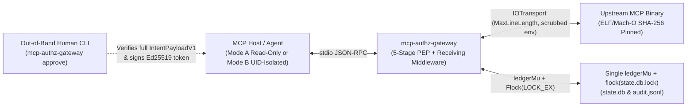

# SPEC-mcp-authz-gateway: Deterministic Authorization, Manifest Pinning & Step-Up Approval Gateway for MCP

| Field | Normative Value |
| :--- | :--- |
| **Specification ID** | `SPEC-AUTHZ-01` (`mcp-authz-gateway` v0.1.0) |
| **Status** | `Normative v0.1.0 — Final Post-Round-3 Adversarial Review` |
| **Target Module** | `github.com/rlwillen0121/identity-mcp` (`cmd/mcp-authz-gateway`, `internal/authz`) |
| **Runtime & SDK** | Go 1.26+ (`//go:build unix` — `darwin`, `linux`, with `!unix` stub), `github.com/modelcontextprotocol/go-sdk` v1.8.0, `github.com/google/jsonschema-go` v0.4.3 (promoted to direct `require`), Go standard library |
| **Transport** | Host-facing `mcp.StdioTransport` (stdin/stdout) $\leftrightarrow$ Upstream `mcp.IOTransport` with `MaxLineLength` bound over child subprocess pipes; diagnostics to `os.Stderr` and `0600` append-only audit log |

---

## 1. Purpose, Scope & Architectural Position

### 1.1 Problem Statement
`identity-mcp` ships five **read-only** MCP servers (`okta-mcp`, `entra-mcp`, `lumos-mcp`, `sailpoint-mcp`, `c1-mcp`) so that coding and IGA agents can answer directory and access-governance questions without holding mutating code paths in those binaries. In enterprise deployments, however, two additional requirements arise:

1. **Scoped On-Behalf-Of (OBO) Delegation:** When an operator agent connects to a write-capable MCP server (or a read-only `identity-mcp` server), the upstream subprocess typically authenticates to the IdP/IGA using a static service credential (`OKTA_API_TOKEN`, `SAILPOINT_CLIENT_SECRET`, etc.). Without a deterministic Policy Enforcement Point (PEP) outside the LLM, the agent exercises the full privileges of the service token rather than the intersection of the human caller's identity claims and the agent's assigned role.
2. **Deterministic Guardrails on Tool Calls:** Prompt-level instructions (*"never modify Tier-0 admin groups"*, *"always ask a human before granting a role"*, *"never approve your own access request"*) are non-deterministic and vulnerable to prompt injection, indirect tool-output injection, and upstream MCP tool-description "rug pulls."

### 1.2 Architectural Solution
`mcp-authz-gateway` is a zero-LLM, deterministic MCP proxy binary (`cmd/mcp-authz-gateway`) and internal package (`internal/authz`) in `github.com/rlwillen0121/identity-mcp`. It interposes between an MCP Host (OpenCode, Claude Code, Codex, or custom orchestrator) and an upstream stdio MCP server subprocess:



### 1.3 Relationship to `identity-mcp` Contracts
1. **Unaltered Read-Only Provider Servers:** The five existing provider packages (`internal/{okta,entra,lumos,sailpoint,c1}`) and shared client (`internal/idmcp`) remain strictly read-only (`Get`, `GetJSON`, `PostForm` for OAuth token exchange, and search-only `PostJSON`).
2. **Zero Network Calls in `internal/authz`:** `internal/authz` makes **zero HTTP or network calls**. All JWT signature checks, policy detached-signature checks, and step-up approval verifications use local pinned public keys, keeping evaluation deterministic, offline-capable, and immune to SSRF or network outages.
3. **Minimal Dependency Surface:** `go.mod` adds **zero new external modules**. `github.com/google/jsonschema-go v0.4.3` (already present in `go.mod` at `v0.4.3` as a transitive dependency of `go-sdk v1.8.0`) is promoted to a direct `require` for normative JSON Schema 2020-12 validation. All cryptography (`crypto/ed25519`, `crypto/ecdsa`, `crypto/rsa`, `crypto/sha256`, `crypto/rand`), CRC32C (`hash/crc32`), canonicalization, and file locking (`syscall.Flock`) use the Go 1.26 standard library.
4. **Cross-Platform Build Hygiene:** `cmd/mcp-authz-gateway/main_unix.go` and `internal/authz/*.go` carry `//go:build unix` (`darwin`, `linux`). A companion `cmd/mcp-authz-gateway/main_other.go` (`//go:build !unix`) prints `"mcp-authz-gateway: unsupported platform (requires darwin or linux)\n"` to `os.Stderr` and exits with code `1`, ensuring `go build ./...` and `go test ./...` succeed on all platforms.

### 1.4 Non-Goals & Explicit Boundaries (v0.1.0)
- **Not a remote HTTP/SSE gateway:** v0.1.0 mediates local stdio MCP servers on local POSIX (`darwin`, `linux`) filesystems.
- **Not a live upstream state oracle:** Because `internal/authz` makes zero upstream HTTP calls:
  - Tier-0 protection matches canonical resource identifiers (`00u...`, `00g...`, UUIDs) and login emails passed in tool arguments; it cannot resolve human display names to IDs at runtime.
  - Separation-of-Duty (SoD) enforcement covers intra-call conflicts, static baseline exclusions (`subject_existing_entitlements`), and permanent grant records persisted in the gateway's local `state.db` (`ledger_id`); it does not query live IdP state for entitlements granted outside this gateway's state ledger.

---

## 2. Trusted Computing Base (TCB), Threat Model & Security Invariants

### 2.1 Trusted Computing Base (TCB) & Deployment Modes (`internal/authz/tcb.go`)

#### 2.1.1 Mandatory Mode Selection (`tcb.isolation_mode`)
`policy.json` declares `tcb.isolation_mode` $\in \{\texttt{"mode_a_read_only"}, \texttt{"mode_b_uid_boundary"}\}$:

1. **Mode A (`"mode_a_read_only"` — Same-UID Host-Enforced Lane, Read-Only Tools Only):**
   - **Hard Restriction:** Mode A is permitted **only** when every enabled tool in `policy.json` has `action_class == "read"`. If any tool with `action_class` $\in \{\texttt{"write:low-risk"}, \texttt{"write:high-risk"}\}$ has `enabled: true` while `isolation_mode == "mode_a_read_only"`, startup fails closed (`MODE_A_WRITE_FORBIDDEN`).
   - **Host-Enforced Allowlist Precondition:** Because the gateway runs under the same OS UID as the host in Mode A, protecting the read-only `upstream.env_file` token depends on the host (OpenCode or Claude Code; Codex has no per-tool gate and must use Mode B) enforcing a strict tool **allowlist** where only the gateway's MCP tools are enabled and all local file-read (`Read`, `Grep`, `Glob`), file-write (`Edit`, `Write`, `NotebookEdit`), shell (`Bash`), web (`WebFetch`, `WebSearch`), subagent (`Task`), and non-gateway MCP servers are disabled (§6.2).
2. **Mode B (`"mode_b_uid_boundary"` — Mandatory for Any Write Tool):**
   - Required whenever any `write:low-risk` or `write:high-risk` tool is enabled.
   - `policy.tcb` declares `service_uid` (`int`, e.g. `991` for user `mcp-authz`) and `forbidden_uids` (`[]int`, non-empty list of agent/caller UIDs such as `[1000, 501]`).
   - **Runtime UID Verification:** When `isolation_mode == "mode_b_uid_boundary"` (unless `allow_same_uid_in_go_test: true` AND Go stdlib `testing.Testing() == true`; setting `allow_same_uid_in_go_test: true` when `testing.Testing() == false` fails startup with `TEST_FLAG_FORBIDDEN_IN_PROD`):
     - `os.Geteuid()` must equal `policy.tcb.service_uid` and must not appear in `policy.tcb.forbidden_uids` (`TCB_UID_BOUNDARY_REQUIRED`).
     - If `SUDO_UID` is present in the environment, it must parse as an integer in `policy.tcb.forbidden_uids` and satisfy `SUDO_UID != service_uid` (`TCB_UID_BOUNDARY_REQUIRED`).
     - `policy.json` and `lockfile_path` must be owned by `uid == 0` (root) with mode `0644` or `0640` (readable by `service_uid` and human approvers, not writable by `service_uid` or any `forbidden_uids`).
     - `upstream.env_file`, `state_db_path`, `state_db_path + ".lock"`, `audit_log_path`, and `challenge_dir` must be owned by `service_uid` with mode `0600` (`0400` also permitted for `upstream.env_file`, `0700` for `challenge_dir`), inaccessible (`000` group/other) to the agent user.
   - **Normative `sudoers` Configuration (Defines `Cmnd_Alias` First, Pins Full `argv`, Restricts `env_keep`):**
     ```text
     Cmnd_Alias MCP_GW = /usr/local/bin/mcp-authz-gateway serve --policy /etc/identity-mcp/policy.json
     Defaults!MCP_GW env_reset, !use_pty, !log_output, env_keep="MCP_AUTHZ_SUBJECT_JWT"
     agent_user ALL=(mcp-authz) NOPASSWD: MCP_GW
     ```
     *(On macOS where `/etc` is a symlink to `/private/etc`, use canonical realpaths `/private/etc/identity-mcp/policy.json` in both `sudoers` and `policy.json`.)*

#### 2.1.2 Zero Path/Env Overrides in `serve` & Admin State Initialization (`init-state`)
1. **`serve` Accepts Only `--policy`:** `mcp-authz-gateway serve` accepts **only** `--policy /abs/real/path/to/policy.json`. All security-critical paths (`lockfile_path`, `state_db_path`, `audit_log_path`, `challenge_dir`, `empty_home_dir`, `upstream.env_file`, `admin_pubkey`, `policy_sig_path`, `ssl_cert_file`, `ssl_cert_dir`) live inside `policy.json` under `tcb` and cannot be overridden via CLI flags or environment variables.
2. **`serve` Never Creates State or Audit Files:** `serve` opens `state_db_path` and `audit_log_path` without `os.O_CREATE`. If either file does not exist or lacks its genesis record, `serve` exits with code `1` (`STATE_LEDGER_UNINITIALIZED` / `AUDIT_LOG_UNINITIALIZED`).
3. **`init-state` Subcommand:** Run once as `service_uid` to create `state.db` (`0600`), `state.db.lock` (`0600`), `audit.jsonl` (`0600`), `challenge_dir` (`0700`), and `empty_home_dir` (`0700`), generate a 128-bit cryptographic random `ledger_id` (`^[0-9a-f]{32}$`), write the genesis `header` and `audit_hwm` records to `state.db`, and write the genesis `seq: 1` record to `audit.jsonl`.

#### 2.1.3 Ancestor-Walking, `O_NOFOLLOW` File Verification (`OpenVerifiedFile`)
Every file and directory opened by the gateway is validated by `OpenVerifiedFile`:
1. **Canonical Absolute Path:** `filepath.IsAbs(p) && filepath.Clean(p) == p` (`TCB_INVALID_PATH`). On macOS (`darwin`), configured paths must use canonical realpaths (`/private/etc/...`, `/private/var/...`) because `/etc`, `/var`, and `/tmp` are system symlinks; unit tests must root temporary directories at `filepath.EvalSymlinks(t.TempDir())`.
2. **Full Ancestor Directory Walk to `/`:** For every ancestor directory $d$ from `filepath.Dir(p)` up to `/`:
   - Call `os.Lstat(d)`. If `d` is a symlink (`mode & os.ModeSymlink != 0`), fail with `TCB_SYMLINK_FORBIDDEN`.
   - Verify `stat.Uid == 0 || stat.Uid == uint32(os.Geteuid())` (`TCB_OWNER_MISMATCH`).
   - Verify `mode.Perm() & 0o022 == 0` (`TCB_PERMISSIONS_TOO_OPEN`). (In `go test` when `testing.Testing() == true`, the sticky-directory permission check `0o022` is exempted only on the root `EvalSymlinks(os.TempDir())` ancestor and above so standard OS test roots work without relaxing checks on any test-created subdirectory.)
3. **`O_NOFOLLOW` Open + `Fstat` + Local-FS Allowlist Verification:**
   - Open with `syscall.Open(p, flags|syscall.O_NOFOLLOW|syscall.O_CLOEXEC, 0)` (returning `TCB_SYMLINK_FORBIDDEN` on `ELOOP` or `EFTYPE`).
   - Call `syscall.Fstat(fd)`: verify regular file (`S_IFREG`) or directory (`S_IFDIR`), owner `Uid == expectedUID`, and `mode & forbiddenPermMask == 0`.
   - Call `syscall.Fstatfs(fd)` and enforce a **local filesystem allowlist** (`TCB_FILESYSTEM_UNSUPPORTED`):
     - On `darwin`: `f_fstypename` must be in `{"apfs", "hfs"}`.
     - On `linux`: `f_type` must be in `{EXT4_SUPER_MAGIC (0xef53), XFS_SB_MAGIC (0x58465342), TMPFS_MAGIC (0x01021994), BTRFS_SUPER_MAGIC (0x9123683e), OVERLAYFS_SUPER_MAGIC (0x794c7630)}`.

---

## 3. CLI Interface & Operational Subcommands

`cmd/mcp-authz-gateway` provides six deterministic subcommands:

1. **`mcp-authz-gateway serve --policy /abs/path/to/policy.json`**
   - Reads only one environment variable: `MCP_AUTHZ_SUBJECT_JWT`.
   - Verifies detached Ed25519 signature at `policy.tcb.policy_sig_path` using `policy.tcb.admin_pubkey` (if configured) over `"MCP-AUTHZ-CONFIG-V1\n" || JCS(policy.json) || "\n" || JCS(mcp-authz.lock.json)`.
2. **`mcp-authz-gateway init-state --policy /abs/path/to/policy.json`**
   - Initializes `state.db`, `state.db.lock`, `audit.jsonl`, `challenge_dir`, and `empty_home_dir` (refusing if `state.db` or `audit.jsonl` already exists and is non-empty).
3. **`mcp-authz-gateway pin --policy /abs/path/to/policy.json [--yes]`**
   - Verifies `upstream.command` (ELF/Mach-O header + SHA-256), spawns the upstream server over `mcp.IOTransport`, fetches all tools via `ListTools`, validates input/output schemas against the allowed JSON Schema subsets (§4.5.2), prints the JCS-escaped summary via `FormatSafeTerminalASCII` to `os.Stderr`, prompts `Write lockfile? [y/N]: ` on `/dev/tty` (unless `--yes`), and writes `policy.tcb.lockfile_path`.
4. **`mcp-authz-gateway approve`**
   ```bash
   mcp-authz-gateway approve \
     --policy /private/etc/identity-mcp/policy.json \
     --intent-file /path/to/challenge-receipt.json \
     --approver-sub "secops-lead@example.com" \
     --signing-key-file ~/.keys/approver.ed25519.key \
     --ttl 180s \
     --ticket "CHG-1042" \
     [--yes]
   ```
   - Loads `policy.json`, `policy.tcb.lockfile_path`, and `--intent-file` (`StepUpChallengeReceiptV1`).
   - Recomputes `policy_sha256`, checks `tool_sha256` and `upstream_binary_sha256` against the lockfile, verifies `intent.GatewayID == policy.GatewayID` and `^[0-9a-f]{32}$` for `intent.LedgerID`, and recomputes `SHA-256(JCS(intent_payload))` (`INTENT_PREIMAGE_MISMATCH` on any mismatch).
   - Verifies that `--signing-key-file` (`0600`/`0400` owned by `os.Geteuid()`, containing `ed25519-priv-hex:<128-lowercase-hex>`) derives the public key in `policy.StepUp.Approvers[approver_sub].PubKey`, and checks Maker-Checker against `intent.PrincipalIdentityID`, `intent.PrincipalSub`, and `intent.PrincipalEmail` (`SELF_APPROVAL_FORBIDDEN`).
   - Renders `intent_payload` to `os.Stderr` using `FormatSafeTerminalASCII`, prompts on `/dev/tty` (setting `claims.Interactive = true`, or `false` when `--yes` is used; note `claims.Interactive` is an approver-signed anti-automation attestation), and prints `mcp_appr_v1.<b64url(payload)>.<b64url(sig)>` to `os.Stdout`.
5. **`mcp-authz-gateway verify-audit --policy /abs/path/to/policy.json`**
   - Under `ledgerMu` + `flock(state.db.lock)`, verifies the entire `audit.jsonl` hash chain from `seq = 1` and verifies `tail == audit_hwm`.
6. **`mcp-authz-gateway repair --policy /abs/path/to/policy.json`** & **`mcp-authz-gateway revoke-grant --policy /abs/path/to/policy.json --subject <id> --entitlement <id> --operator <sub_or_email> --ticket <id>`**
   - `repair` (run as `service_uid` under `flock(state.db.lock)`) inspects `state.db` and `audit.jsonl`: if and only if the **final** line of either file lacks a trailing `\n` or fails JSON/CRC/hash verification (a torn crash write while all preceding lines `1..N-1` are valid), truncates that incomplete final line, reconciles `audit_hwm` if `tail == hwm + 1`, and appends an audited `ledger_repaired` event. Corruption on any non-final line refuses repair (`STATE_LEDGER_UNAVAILABLE` / `AUDIT_LOG_CORRUPTED`).
   - `revoke-grant` (run as `service_uid` under `flock(state.db.lock)`) appends a `grant_revoke` record to `state.db` and an audited `grant_revoked` record (recording `--operator` and `--ticket`) to `audit.jsonl`.

---

## 4. Normative Control Specifications (7 Controls, 5 Evaluation Stages)

---

### 4.1 Control 1: Upstream Binary & Tool Manifest Pinning (`internal/authz/pin.go`)

#### 4.1.1 Binary Verification & Subprocess Launch (`VerifyUpstreamBinary`)
1. `upstream.command` is opened via `OpenVerifiedFile` (`O_RDONLY | syscall.O_NOFOLLOW | syscall.O_CLOEXEC`).
2. Reads the first 4 bytes from `fd` and requires an ELF (`\x7fELF`) or Mach-O (`\xfe\xed\xfa\xce`, `\xfe\xed\xfa\xcf`, `\xce\xfa\xed\xfe`, `\xcf\xfa\xed\xfe`, `\xca\xfe\xba\xbe`) magic header. Script shebangs (`#!`) fail with `UPSTREAM_SCRIPT_INTERPRETER_FORBIDDEN`.
3. Computes `sha256` over the open `fd` and verifies equality with `lockfile.UpstreamBinarySHA256` (`MANIFEST_PIN_MISMATCH`).
4. **Direct `exec.Cmd` + `mcp.IOTransport` Construction (No `LookPath`, Bounded Frame Length):**
   - To avoid `exec.LookPath` and bound inbound JSON-RPC line memory before decoding, the gateway constructs `exec.Cmd` directly:
     - On Linux: verifies `/proc/self/fd/<fd>` exists (`MANIFEST_PIN_MISMATCH` if `/proc` is unmounted) and sets `cmd.Path = fmt.Sprintf("/proc/self/fd/%d", fd)` (keeping `fd` open in the parent until `cmd.Start()` returns; because `execve` resolves the ELF binary before closing `O_CLOEXEC` descriptors, `O_CLOEXEC` remains set on `fd` and `ExtraFiles` is not used).
     - On macOS: sets `cmd.Path = policy.Upstream.Command` (protected by `OpenVerifiedFile` ancestor ownership/permissions).
     - Sets `cmd.Args = append([]string{policy.Upstream.Command}, policy.Upstream.Args...)`, `cmd.Env = BuildChildEnv(...)`, and creates `stdinPipe`, `stdoutPipe`, and `stderrPipe`.
   - Connects the upstream `mcp.Client` over `&mcp.IOTransport{Reader: stdoutPipe, Writer: stdinPipe, MaxLineLength: policy.Upstream.MaxOutputBytes + 65536}` (and terminates the child process with `SIGKILL` on session close).

#### 4.1.2 Canonical Tool Surface, Cache Bypass & Generation-Counter Epoch Synchronization
1. **Bypassing `go-sdk` `toolsCache` (`Client.AddSendingMiddleware`):**
   - In `go-sdk v1.8.0` (`mcp/client.go:1265`, `mcp/cache.go:37`), `ClientSession.ListTools` caches results when `result.GetTTLMs() > 0`.
   - The gateway installs a sending middleware on its upstream `mcp.Client` via `upstreamClient.AddSendingMiddleware` that intercepts every `tools/list` response and sets `res.TTLMs = 0`, ensuring `cs.toolsCache` never caches tool lists and every `reverifyManifest` call hits the upstream wire.
2. **Generation-Counter Dirty Tracking (`notifiedGen` vs `verifiedGen`):**
   - The gateway maintains `epochMu sync.RWMutex`, `poisoned atomic.Bool`, `upstreamDead atomic.Bool`, `notifiedGen atomic.Uint64` (initialized to `1`), and `verifiedGen atomic.Uint64` (initialized to `1` after startup pin verification).
   - `ToolListChangedHandler` is non-blocking and only executes `gw.notifiedGen.Add(1)`.
   - The manifest is considered dirty iff `gw.notifiedGen.Load() != gw.verifiedGen.Load()`.
   - **`read` tools (and `tools/list`) when `notifiedGen.Load() == verifiedGen.Load()`:** Acquire `epochMu.RLock()`, re-check `!poisoned.Load() && !upstreamDead.Load() && notifiedGen.Load() == verifiedGen.Load()`, and hold `RLock` across `upstreamSession.CallTool`.
   - **Whenever `notifiedGen.Load() != verifiedGen.Load()` OR the call is `write:low-risk` / `write:high-risk` (with `reverify_manifest_before_write: true`):**
     - Acquire `epochMu.Lock()`.
     - Snapshot `g := gw.notifiedGen.Load()`, fetch all upstream tools via `upstreamSession.ListTools` (enforcing cursor-loop guard and 250-tool cap), and verify against `lockfile`.
     - If verification fails: set `gw.poisoned.Store(true)`, close `upstreamSession`, kill the child process, release `epochMu.Lock()`, log an `ABORT` audit record, and return `MANIFEST_RUG_PULL_DETECTED`.
     - If verification succeeds: set `gw.verifiedGen.Store(g)`. (If another notification arrived during `ListTools`, `notifiedGen` is now `> g`, so the dirty condition is never lost!) For `write:*` calls, keep `epochMu.Lock()` held through Stage 4 state commit, pre-forward audit, and `upstreamSession.CallTool`.

---

### 4.2 Control 2: Caller Identity & OBO Scope Intersection (`internal/authz/jwt.go`, `internal/authz/obo.go`)

1. **`require_jwt: false`:** Allowed only when `isolation_mode == "mode_a_read_only"`, all enabled tools are `"read"`, and `anonymous_scopes` is non-empty (`WRITE_TOOL_REQUIRES_JWT`).
2. **`require_jwt: true`:**
   - `allow_per_call_jwt: true` is forbidden whenever any `write:*` tool is enabled or `hide_unauthorized_tools == true` (`PER_CALL_JWT_FORBIDDEN`).
   - When `allow_per_call_jwt == false`, any request with `_meta["io.identity-mcp/subject_jwt"]` fails with `PRINCIPAL_TOKEN_OVERRIDE_FORBIDDEN`.
   - Verifies JWS (`EdDSA`, `ES256` raw 64-byte $R\|S$, `RS256` $\ge 2048$-bit), rejects `jwk`/`jku`/`x5u`/`x5c`/`crit` headers, checks `iss`, `aud` (string or `[]string`), `sub != ""`, and live temporal bounds (`exp`, `iat`, `nbf` with `max_clock_skew_seconds`).
   - Extracts `PrincipalIdentityID = jwt[principal_auth.identity_claim]` (e.g., `"uid"` for Okta access tokens or `"oid"` for Entra ID), which must match `principal_auth.identity_regex` (`PRINCIPAL_JWT_EXPIRED_OR_INVALID`).
   - Extracts `PrincipalEmail` using deterministic claim precedence `email` $>$ `upn` $>$ `preferred_username` (the first present claim becomes `PrincipalEmail`, and every present claim among those three must pass the `email_or_upn` normalizer or the JWT is rejected with `PRINCIPAL_JWT_EXPIRED_OR_INVALID`).
3. **OBO Intersection:**
   - Rejects JWTs containing `_claim_names`, `_claim_sources`, or `"hasgroups": true` (`PRINCIPAL_GROUP_OVERAGE_UNSUPPORTED`).
   - Any scope in policy or JWT containing `*` or failing `^[a-z0-9_]+(:[a-z0-9_]+){1,3}$` fails with `WILDCARD_SCOPE_FORBIDDEN` (at policy load) or `PRINCIPAL_JWT_EXPIRED_OR_INVALID` (in JWT).
   - Evaluates $S_{\text{eff}} = S_{\text{human}} \cap S_{\text{agent}}$ and requires $S_{\text{req}}(t) \neq \emptyset \wedge S_{\text{req}}(t) \subseteq S_{\text{eff}}$ (`OBO_SCOPE_DENIED`).

---

### 4.3 Control 3: Canonical Identifier Guardrails, Tier-0, Self-Dealing & SoD (`internal/authz/policy.go`)

1. **Action Classes & Startup Hint Sanity Check:**
   - `action_class` $\in \{\texttt{"read"}, \texttt{"write:low-risk"}, \texttt{"write:high-risk"}\}$ is authoritative.
   - At startup, if a tool has `action_class == "read"`, its lockfile entry must have `read_only_hint == true` and `destructive_hint == false` (`READ_CLASS_ANNOTATION_MISMATCH`).
2. **Startup Validation of Policy Identifiers (`POLICY_IDENTIFIER_NONCANONICAL`):**
   - At policy load, the gateway validates that:
     - Every entry in `protected_resources.<cat>.exact` passes the `normalizer` and `canonical_regex` of every `protected_target_binding` that references `<cat>`.
     - Every entitlement in `sod_rules[*].conflicting_entitlements` and `subject_existing_entitlements` values matches every `sod_binding.entitlement_canonical_regex`, and every subject key in `subject_existing_entitlements` matches `sod_binding.subject_canonical_regex`.
     - Every entry in `step_up.approvers` has a non-empty `principal_ids` slice where every element matches `principal_auth.identity_regex`, and a non-empty `emails` slice where every element passes `email_or_upn`.
3. **Runtime Stage 3 Checks:**
   - **Extraction (`ExtractStrings`):** `optional: true` allows only the root segment (or the array field before `[*]`) to be absent/`null`. Any present array must have `len >= 1` and every element must resolve the leaf string (`REQUIRED_TARGET_ARG_MISSING` / `ARGUMENT_TYPE_INVALID`).
   - **Normalizers & `canonical_regex`:** Rejects non-ASCII runes, control chars, and reserved self-aliases (`"me"`, `"self"`, `"current"`, `"default"`, `"@me"`) with `INVALID_IDENTIFIER_CHARS`, then enforces the binding's `canonical_regex` (`NON_CANONICAL_IDENTIFIER`) and applies `case_mode` (`"preserve"`, `"ascii_lower"`, `"ascii_upper"`).
   - **Tier-0 Denylist:** Matches canonicalized targets against bound `protected_resources` categories (`TIER0_PROTECTED_TARGET`).
   - **Self-Dealing (`forbid_self_target`):** Mandatory explicit boolean on all `write:*` tools (`MISSING_SELF_TARGET_POLICY`). Requires all bound `jwt_claims` to be present and canonical (`SELF_DEALING_CLAIM_MISSING`) and denies if any target matches a bound caller claim (`SELF_DEALING_FORBIDDEN`).
   - **Permanent SoD (`sod_rules` & `sod_binding`):** `sod_binding` is permitted only on grant/assignment tools. For each canonical subject $u \in U$ and each `sod_rule`, if $E_{\text{req}}$ intersects `rule.conflicting_entitlements` ($E_{\text{req}} \cap C \neq \emptyset$) **and** $|(E_{\text{req}} \cup E_{\text{static}}(u) \cup E_{\text{ledger}}(u)) \cap C| \ge 2$, deny with `SOD_CONFLICT_DETECTED` (checking $E_{\text{req}} \cap C \neq \emptyset$ ensures a pre-existing baseline violation in $E_{\text{static}}(u)$ does not block unrelated grants).

---

### 4.4 Control 4: Preimage-Bound Step-Up Approval & Unified State/Audit Ledger (`internal/authz/stepup.go`, `internal/authz/statedb.go`)

#### 4.4.1 Approval Token Channels & Verification
- For `write:high-risk` tools, the approval token may be passed either in the injected tool argument `__mcp_authz_approval_token` or in request `_meta["io.identity-mcp/approval_token"]` (if both are present and differ, return `AMBIGUOUS_APPROVAL_TOKEN`).
- If any upstream tool natively declares a property colliding with `__mcp_authz_approval_token` under `asciiLower`, `pin` and `serve` fail at startup with `RESERVED_ARGUMENT_COLLISION`.
- At policy load, the gateway verifies that no `pubkey` in `step_up.approvers` is duplicated across approvers or equals any key in `principal_auth.public_keys` or `tcb.admin_pubkey` (`KEY_REUSE_FORBIDDEN`), and rejects known RFC 8032 test keys (`KNOWN_TEST_KEY_FORBIDDEN`).
- At runtime, verifies `ApprovalTokenClaimsV1` signature against `approvers[approver_sub].pubkey`, verifies Maker-Checker against `principal.IdentityID`, `principal.Sub`, `principal.Email`, `approver.PrincipalIDs`, and `approver.Emails` (`SELF_APPROVAL_FORBIDDEN`), and verifies `intent_digest` and `ledger_id`.

#### 4.4.2 Single `ledgerMu` + Single `lockFd` & Cross-Process Inode Freshness
1. **Single Process Mutex & Single Lock Descriptor:**
   `internal/authz` holds **exactly one** process-wide `ledgerMu sync.Mutex` and **exactly one** `lockFd`, opened once at startup on `state_db_path + ".lock"` (`0600`). Every read or write of `state.db` or `audit.jsonl` executes as:
   ```go
   gw.ledgerMu.Lock()
   defer gw.ledgerMu.Unlock()
   syscall.Flock(gw.lockFd, syscall.LOCK_EX)
   defer syscall.Flock(gw.lockFd, syscall.LOCK_UN)
   ```
   This single critical section governs state commits, challenge rate-limit records, all audit appends (startup, allow, deny, challenge, timeout, cancel, protocol deny), `audit_hwm` updates, compaction, startup verification, `verify-audit`, `repair`, and `revoke-grant`. No other mutex guards these files. Global lock acquisition order is strictly `epochMu` $\rightarrow$ `ledgerMu` $\rightarrow$ `flock(lockFd)`; `epochMu` is never acquired while `ledgerMu` is held.
2. **Zero Stale FD / Inode Retention Across Lock Releases:**
   No `state.db` or `audit.jsonl` file descriptor or parsed state is trusted across lock releases. Inside each `ledgerMu` + `flock(lockFd)` critical section:
   1. Open `state.db` via `OpenVerifiedFile(O_RDWR|O_APPEND)` and `audit.jsonl` via `OpenVerifiedFile(O_RDWR|O_APPEND)`.
   2. Read and CRC32C-verify all records in `state.db`. (In-memory cache optimization: cache parsed records keyed on `fstat` `(dev, ino, size)`; when `(dev, ino)` match the cached inode and `currentSize >= cachedSize`, read and verify only bytes in `[cachedSize, currentSize)`; whenever `(dev, ino)` differ after another process's compaction rename, discard the cache and read the new inode from offset `0`.)
   3. Evaluate rolling budgets (keyed by `(ledger_id, principal_identity_id)`), SoD grants, and `jti` replay.
   4. Append new state record(s) to `state.db`, append the new `AuditRecordV1` (deriving `seq = hwm.AuditSeq + 1` and `prev_hash = hwm.AuditHash` from the freshly read `audit_hwm`, never from process memory) to `audit.jsonl` + `fsync(auditFd)`, and append the updated `audit_hwm` record (`audit_seq = seq`, `audit_hash = record.RecordHash`) to `state.db` + `fsync(stateFd)`.
   5. If `state.db` size exceeds 4 MiB, compact inside the same critical section via `state.db.tmp` (`0600`) $\rightarrow$ `fsync(tmpFd)` $\rightarrow$ `close(tmpFd)` $\rightarrow$ `os.Rename("state.db.tmp", "state.db")` $\rightarrow$ `fsync(dirFd)`.
   6. Close `stateFd` and `auditFd` before releasing `flock(lockFd)` and `ledgerMu`.

#### 4.4.3 Target Count & Normative 3-Phase Write Execution Under `epochMu.Lock()`
- Every `write:*` tool in `policy.json` must declare `primary_target_path` (`PathExpr`); `target_count` is the number of canonical target strings extracted from `primary_target_path` ($\ge 1$). At policy load, if any `write:*` tool is enabled while `max_write_calls_per_minute == 0` or `max_write_targets_per_window == 0`, or if any `write:high-risk` tool is enabled while `max_challenges_per_minute == 0`, policy load fails (`ZERO_WRITE_BUDGET_ON_WRITE_TOOL`).
- While holding `epochMu.Lock()`:
  - **Phase 1 (Manifest Re-Verify):** Snapshot `g := notifiedGen.Load()`, call `upstreamSession.ListTools`, verify against `lockfile`, and set `verifiedGen.Store(g)`.
  - **Phase 2 (Atomic State + Pre-Forward Audit Commit):** Acquire `ledgerMu` + `flock(lockFd)` once. Verify `(ledger_id, principal_identity_id)` budgets (`PRINCIPAL_WRITE_BUDGET_EXHAUSTED`), permanent SoD (`SOD_CONFLICT_DETECTED`), and `jti` replay (`APPROVAL_TOKEN_REPLAYED`). Append `budget`, `grant` (if `sod_binding`), and `replay` (`jti`) records to `state.db`, append `"pre_forward_allow"` to `audit.jsonl` + `fsync(auditFd)`, and append `audit_hwm` to `state.db` + `fsync(stateFd)`. Release `flock` + `ledgerMu`. If `audit.jsonl` or `state.db` write/fsync fails during Phase 2, append an `aborted_after_commit` marker if possible, close files, and return `AUDIT_LOG_UNAVAILABLE` / `STATE_LEDGER_UNAVAILABLE` without calling upstream. (For `read` tools, if the audit log write fails, the gateway also fails closed with `AUDIT_LOG_UNAVAILABLE` before returning data.)
  - **Phase 3 (Upstream Forward & Post-Forward Audit):** Call `upstreamSession.CallTool(ctx, params)`, sanitize output (§4.7.4), acquire `ledgerMu` + `flock(lockFd)` to append `"post_forward_result"` to `audit.jsonl` + `audit_hwm` to `state.db`, and release `epochMu.Lock()`. Note that SoD `grant`, `budget`, and `replay` records committed in Phase 2 remain committed even if the upstream call in Phase 3 fails or times out (use `revoke-grant` to clear a failed upstream grant).

---

### 4.5 Control 5: Strict JSON Decoding, Schema Subsets & JCS (`internal/authz/jcs.go`)

1. **`DecodeStrictJSON`:** Enforces `<= 64 KiB`, depth $\le 16$, exact duplicate-key rejection (`DUPLICATE_JSON_KEY`), ASCII case-colliding key rejection on `arguments`/JWTs/approvals (`CASE_COLLIDING_JSON_KEY`), `int53` bounds (`JSON_INTEGER_PRECISION_LOSS`), and control/bidi rejection (`INVALID_CONTROL_CHAR`).
2. **Stage 1.2 Limit Default Injection & Schema Validation:**
   - Strips `__mcp_authz_approval_token` (if `write:high-risk`).
   - Injects `limit_arg_bindings` `default_value` (validated at policy load to satisfy $1 \le \text{default\_value} \le \text{max\_value}$) when the field is absent/`null`.
   - Rejects unknown object keys recursively against `inputSchema.properties` (`UNKNOWN_TOOL_ARGUMENT`) and validates `clean_arguments` with `jsonschema-go` (`SCHEMA_VALIDATION_FAILED`).
3. **Input vs. Output JSON Schema Subsets (Confirmed Against `jsonschema-go v0.4.3`):**
   - **`inputSchema` Subset:** Root must have `"type": "object"`. Allowed keywords: `$schema`, `type`, `title`, `description`, `properties`, `required`, `additionalProperties` (`false` only on object nodes), `items`, `enum`, `const`, `minimum`, `maximum`, `minLength`, `maxLength`, `minItems`, `maxItems`, `pattern`, `format`. Slice properties inferred by `jsonschema-go` as `"type": ["null", "array"]` (with `items.type == "string"`) are supported; all other type arrays, `$ref`, `$defs`, `anyOf`, `oneOf`, `allOf`, `not`, `if`/`then`/`else`, `patternProperties`, and `"default"` (anywhere on `write:*` tools, or along bound paths on `read` tools) are rejected (`UPSTREAM_SCHEMA_UNSUPPORTED` / `UPSTREAM_SCHEMA_DEFAULT_FORBIDDEN`).
   - **`outputSchema` Subset:** Because `jsonschema-go`'s `For[T]` infers Go slices as `"type": ["null", "array"]` and Go `map[string]string` (e.g. `okta.UserDetail.Profile`) as `"type": "object"` with a schema-valued `additionalProperties: {"type": "string"}`, the gateway's `outputSchema` validator permits `"type": ["null", T]` pairs and schema-valued `additionalProperties` on output schemas while still forbidding `$ref` and remote `$schema` fetching.

---

### 4.6 Control 6: Subprocess Isolation, Secret Set & Audit Recovery (`internal/authz/audit.go`)

1. **Deterministic Child Subprocess Environment (`BuildChildEnv`):**
   - Sets fixed `PATH=/usr/bin:/bin`, `HOME=<policy.tcb.empty_home_dir>`, `LANG=C.UTF-8`, `TZ=UTC`, and optional `SSL_CERT_FILE` / `SSL_CERT_DIR` sourced strictly from `policy.tcb` (verified via `OpenVerifiedFile`).
   - Reads key-value pairs solely from `policy.Upstream.EnvFile`, restricted to keys in `policy.Upstream.PassEnv`.
   - Rejects any key in `PassEnv` or `EnvFile` matching `MCP_AUTHZ_*`, `LD_*`, `DYLD_*`, `GODEBUG`, `GOFLAGS`, `GOPATH`, `GOROOT`, `PATH`, `HOME`, `LANG`, `TZ`, `SSL_CERT_*`, `*_PROXY`, or `*_proxy` (`FORBIDDEN_PASS_ENV`).
2. **Explicit Secret Key Set (`upstream.secret_env_keys`):**
   - `policy.upstream.secret_env_keys` declares which keys in `pass_env` hold secrets (e.g., `["OKTA_API_TOKEN"]`; must be a non-empty subset of `pass_env`). Non-secret configuration variables (such as `OKTA_ORG_URL`) are omitted from `secret_env_keys` so normal tool outputs containing the org URL are never falsely flagged as secret leaks.
   - At startup, every value in `EnvFile` for a key in `secret_env_keys` must have length in $[16, 8192]$ bytes (so its longest derived base64/URL-encoded form never exceeds the 32 KiB sliding-window cap; otherwise startup fails with `INVALID_SECRET_ENV_VALUE`).
   - `authz.RedactSecrets` and `authz.ContainsSecret` scan solely for the values of `secret_env_keys` (plus their URL-escaped and 3-alignment base64/base64url variants) and `MCP_AUTHZ_SUBJECT_JWT`.
3. **Startup Audit Verification & 1-Record HWM Crash Recovery:**
   - Every audit append (across all events: startup, allow, deny, challenge, timeout, cancel, protocol deny) updates `audit_hwm` inside the same `ledgerMu` + `flock(lockFd)` critical section (§4.4.2).
   - At `serve` startup (under `ledgerMu` + `flock`), the gateway verifies the entire `audit.jsonl` chain from `seq = 1`:
     - If `tail.Seq == hwm.AuditSeq && tail.RecordHash == hwm.AuditHash`, startup proceeds.
     - If `tail.Seq == hwm.AuditSeq + 1 && tail.PrevHash == hwm.AuditHash` and `tail.RecordHash` is valid (which occurs if the previous process crashed after `fsync(auditFd)` and before `fsync(stateFd)`), the gateway appends the catching-up `audit_hwm` record plus an audited `hwm_recovered` event and proceeds.
     - Any other discrepancy (`tail.Seq < hwm.AuditSeq`, broken hash link, or `tail.Seq > hwm.AuditSeq + 1`) fails closed with `AUDIT_LOG_CORRUPTED`.
4. **Unambiguous JCS-First Terminal Escaping (`FormatSafeTerminalASCII`):**
   - First encodes any string through RFC 8785 JCS string serialization (which escapes literal `\` as `\\` and `"` as `\"`), and then replaces any remaining byte `< 0x20` or `>= 0x7F` with `\uXXXX` / `\UXXXXXXXX`. Thus a literal `"\\u000a"` in input renders as `"\\u000a"` whereas an actual newline renders as `"\u000a"`.

---

### 4.7 Control 7: Default-Deny Protocol Mediation & Output Sanitization (`internal/authz/proxy.go`)

1. **Host-Facing `ServerOptions` (Suppresses Default `logging` Capability):**
   - Confirmed in `go-sdk v1.8.0` (`mcp/server.go:117-137`): a `nil` `Capabilities` advertises `{"logging":{}}` by default.
   - Therefore, the gateway constructs its host-facing server with:
     ```go
     mcp.NewServer(&mcp.Implementation{Name: policy.ServerName, Version: "0.1.0"}, &mcp.ServerOptions{
         Capabilities: &mcp.ServerCapabilities{
             Tools: &mcp.ToolCapabilities{ListChanged: false},
         },
     })
     ```
     This suppresses `logging`, `prompts`, and `resources` capabilities and sets `tools.listChanged: false`, matching the receiving middleware's `-32601 METHOD_NOT_ALLOWED` rejection of `logging/setLevel`, `resources/*`, and `prompts/*`.
2. **Upstream `CallToolResult` Sanitization:**
   - Reconstructs a clean `*mcp.CallToolResult` (`Meta: nil`, `IsError: upstreamRes.IsError`, only `TextContent`/`ImageContent`/`AudioContent` with item `Meta: nil, Annotations: nil`).
   - Rejects `EmbeddedResource` or `ResourceLink` (`UPSTREAM_OUTPUT_RESOURCE_FORBIDDEN`).
   - Validates `StructuredContent` against `outputSchema` when `!upstreamRes.IsError && outputSchema != nil` (`UPSTREAM_OUTPUT_SCHEMA_VIOLATION`), and clears `StructuredContent = nil` when `upstreamRes.IsError == true`.
   - Checks serialized output with `authz.ContainsSecret` (`UPSTREAM_OUTPUT_SECRET_DETECTED`).

---

## 5. Policy Configuration Examples (`policy.json`)

Only `pin_mode: "strict_all"` is valid in v0.1.0.

### 5.1 Example A: Mode A Read-Only `okta-mcp` (Canonical macOS Paths, `uid` Claim)
Matches `internal/okta/server.go` (`list_users`, `list_admins`) and `internal/okta/types.go`:
```json
{
  "schema_version": "mcp-authz-policy/v1",
  "gateway_id": "local-okta-read-gw-01",
  "server_name": "okta-mcp",
  "pin_mode": "strict_all",
  "reverify_manifest_before_write": true,
  "tcb": {
    "isolation_mode": "mode_a_read_only",
    "lockfile_path": "/private/etc/identity-mcp/okta-read.lock.json",
    "state_db_path": "/private/var/lib/identity-mcp/okta-read/state.db",
    "audit_log_path": "/private/var/lib/identity-mcp/okta-read/audit.jsonl",
    "challenge_dir": "/private/var/lib/identity-mcp/okta-read/challenges",
    "empty_home_dir": "/private/var/lib/identity-mcp/okta-read/empty-home"
  },
  "upstream": {
    "command": "/usr/local/bin/okta-mcp",
    "args": [],
    "env_file": "/private/etc/identity-mcp/okta-read.env",
    "pass_env": ["OKTA_ORG_URL", "OKTA_API_TOKEN"],
    "secret_env_keys": ["OKTA_API_TOKEN"],
    "call_timeout_ms": 15000,
    "max_output_bytes": 4194304
  },
  "principal_auth": {
    "require_jwt": true,
    "identity_claim": "uid",
    "identity_regex": "^00u[A-Za-z0-9]{17}$",
    "identity_case_mode": "preserve",
    "allowed_algs": ["EdDSA", "ES256", "RS256"],
    "issuer": "https://auth.example.com",
    "audience": "mcp-authz-gateway",
    "max_clock_skew_seconds": 30,
    "max_token_lifetime_seconds": 86400,
    "allow_per_call_jwt": false,
    "public_keys": {
      "idp-key-2026-01": "ed25519-hex:<64-hex-idp-ed25519-public-key>"
    },
    "scope_claims": ["scp"],
    "claim_to_scope_map": {
      "groups": {
        "iam-auditors": ["okta:users:read", "okta:admins:read"]
      }
    }
  },
  "agent_profile": {
    "agent_id": "iga-operator",
    "allowed_scopes": ["okta:users:read", "okta:admins:read"],
    "hide_unauthorized_tools": true,
    "budget_window_seconds": 3600,
    "max_write_calls_per_minute": 0,
    "max_write_targets_per_window": 0,
    "max_challenges_per_minute": 0
  },
  "protected_resources": {},
  "sod_rules": [],
  "step_up": {
    "max_approval_ttl_seconds": 300,
    "require_interactive_tty": true,
    "ticket_regex": "^(?:INC|REQ|CHG)-[0-9]{4,8}$",
    "approvers": {}
  },
  "tools": {
    "list_users": {
      "enabled": true,
      "action_class": "read",
      "required_scopes": ["okta:users:read"],
      "limit_arg_bindings": [
        {"path": "limit", "default_value": 50, "max_value": 100}
      ]
    },
    "list_admins": {
      "enabled": true,
      "action_class": "read",
      "required_scopes": ["okta:admins:read"],
      "limit_arg_bindings": [
        {"path": "limit", "default_value": 50, "max_value": 50}
      ]
    }
  }
}
```

### 5.2 Example B: Mode B UID-Isolated Write Gateway (`okta-write-mcp`, Exact 20-Char Okta IDs)
```json
{
  "schema_version": "mcp-authz-policy/v1",
  "gateway_id": "prod-okta-write-gw-01",
  "server_name": "okta-write-mcp",
  "pin_mode": "strict_all",
  "reverify_manifest_before_write": true,
  "tcb": {
    "isolation_mode": "mode_b_uid_boundary",
    "service_uid": 991,
    "forbidden_uids": [501, 1000],
    "lockfile_path": "/private/etc/identity-mcp/okta-write.lock.json",
    "state_db_path": "/private/var/lib/identity-mcp/okta-write/state.db",
    "audit_log_path": "/private/var/lib/identity-mcp/okta-write/audit.jsonl",
    "challenge_dir": "/private/var/lib/identity-mcp/okta-write/challenges",
    "empty_home_dir": "/private/var/lib/identity-mcp/okta-write/empty-home",
    "admin_pubkey": "ed25519-hex:<64-hex-admin-ed25519-public-key>",
    "policy_sig_path": "/private/etc/identity-mcp/okta-write.policy.sig"
  },
  "upstream": {
    "command": "/usr/local/bin/okta-write-mcp",
    "args": [],
    "env_file": "/private/etc/identity-mcp/okta-write.env",
    "pass_env": ["OKTA_ORG_URL", "OKTA_API_TOKEN"],
    "secret_env_keys": ["OKTA_API_TOKEN"],
    "call_timeout_ms": 15000,
    "max_output_bytes": 4194304
  },
  "principal_auth": {
    "require_jwt": true,
    "identity_claim": "uid",
    "identity_regex": "^00u[A-Za-z0-9]{17}$",
    "identity_case_mode": "preserve",
    "allowed_algs": ["EdDSA", "ES256", "RS256"],
    "issuer": "https://auth.example.com",
    "audience": "mcp-authz-gateway",
    "max_clock_skew_seconds": 30,
    "max_token_lifetime_seconds": 86400,
    "allow_per_call_jwt": false,
    "public_keys": {
      "idp-key-2026-01": "ed25519-hex:<64-hex-idp-ed25519-public-key>"
    },
    "claim_to_scope_map": {
      "groups": {
        "iam-operators": ["okta:groups:assign"]
      }
    }
  },
  "agent_profile": {
    "agent_id": "iga-operator-write",
    "allowed_scopes": ["okta:groups:assign"],
    "hide_unauthorized_tools": true,
    "budget_window_seconds": 3600,
    "max_write_calls_per_minute": 5,
    "max_write_targets_per_window": 10,
    "max_challenges_per_minute": 10
  },
  "protected_resources": {
    "user_ids": {
      "case_insensitive": false,
      "exact": ["00u000000breakglass1", "00u000000000000ceo01"]
    },
    "group_ids": {
      "case_insensitive": false,
      "exact": ["00g000000superadmins", "00g0000000tier0infra"]
    }
  },
  "sod_rules": [
    {
      "rule_id": "SOD-FIN-01",
      "conflicting_entitlements": ["00g000000apinitiator", "00g0000000apapprover"],
      "case_insensitive": false
    }
  ],
  "subject_existing_entitlements": {
    "00u000000000000bob01": ["00g000000apinitiator"]
  },
  "step_up": {
    "max_approval_ttl_seconds": 300,
    "require_interactive_tty": true,
    "ticket_regex": "^(?:INC|REQ|CHG)-[0-9]{4,8}$",
    "approvers": {
      "secops-lead@example.com": {
        "pubkey": "ed25519-hex:<64-hex-secops-lead-ed25519-public-key>",
        "principal_ids": ["00u0000000secopslead"],
        "emails": ["secops-lead@example.com"]
      },
      "iam-oncall@example.com": {
        "pubkey": "ed25519-hex:<64-hex-iam-oncall-ed25519-public-key>",
        "principal_ids": ["00u00000000iamoncall"],
        "emails": ["iam-oncall@example.com"]
      }
    }
  },
  "tools": {
    "assign_user_to_group": {
      "enabled": true,
      "action_class": "write:high-risk",
      "required_scopes": ["okta:groups:assign"],
      "forbid_self_target": true,
      "primary_target_path": "user_id",
      "subject_target_bindings": [
        {
          "path": "user_id",
          "jwt_claims": ["uid"],
          "normalizer": "id_alnum",
          "canonical_regex": "^00u[A-Za-z0-9]{17}$",
          "case_mode": "preserve",
          "optional": false
        }
      ],
      "protected_target_bindings": [
        {
          "path": "user_id",
          "categories": ["user_ids"],
          "normalizer": "id_alnum",
          "canonical_regex": "^00u[A-Za-z0-9]{17}$",
          "case_mode": "preserve",
          "optional": false
        },
        {
          "path": "group_id",
          "categories": ["group_ids"],
          "normalizer": "id_alnum",
          "canonical_regex": "^00g[A-Za-z0-9]{17}$",
          "case_mode": "preserve",
          "optional": false
        }
      ],
      "sod_binding": {
        "subject_path": "user_id",
        "subject_normalizer": "id_alnum",
        "subject_canonical_regex": "^00u[A-Za-z0-9]{17}$",
        "subject_case_mode": "preserve",
        "entitlement_path": "group_id",
        "entitlement_normalizer": "id_alnum",
        "entitlement_canonical_regex": "^00g[A-Za-z0-9]{17}$",
        "entitlement_case_mode": "preserve"
      },
      "arg_constraints": {
        "required_non_empty": ["user_id", "group_id", "ticket_id", "justification"],
        "regex_match": {
          "ticket_id": "^(?:INC|REQ|CHG)-[0-9]{4,8}$"
        }
      },
      "redact_args": []
    }
  }
}
```

---

## 6. Package Layout & Host Configuration Rules

### 6.1 Repository Layout
```text
identity-mcp/
├── cmd/
│   ├── okta-mcp/main.go
│   ├── entra-mcp/main.go
│   ├── lumos-mcp/main.go
│   ├── sailpoint-mcp/main.go
│   ├── c1-mcp/main.go
│   └── mcp-authz-gateway/
│       ├── main_unix.go            # //go:build unix — serve, init-state, pin, approve, verify-audit, repair, revoke-grant
│       └── main_other.go           # //go:build !unix — exits 1 with unsupported platform message
├── internal/
│   ├── idmcp/                      # Existing shared read-only helpers (untouched)
│   ├── okta/                       # Existing (untouched)
│   ├── entra/                      # Existing (untouched)
│   ├── lumos/                      # Existing (untouched)
│   ├── sailpoint/                  # Existing (untouched)
│   ├── c1/                         # Existing (untouched)
│   └── authz/                      # //go:build unix
│       ├── tcb.go                  # OpenVerifiedFile (ancestor walk, O_NOFOLLOW, Fstat, statfs allowlist, UID check)
│       ├── jcs.go                  # RFC 8785 JCS + strict duplicate/ASCII-case-colliding JSON decoder
│       ├── pin.go                  # Control 1: ELF/Mach-O check, IOTransport, generation-counter epochMu
│       ├── jwt.go                  # Control 2: Offline EdDSA/ES256(raw R||S)/RS256 JWT verifier
│       ├── obo.go                  # Control 2: Claim-to-scope mapping & OBO intersection
│       ├── policy.go               # Control 3: PathExpr, canonical_regex, Tier-0/Self-dealing/SoD
│       ├── stepup.go               # Control 4: IntentPayloadV1, preimage verifier, per-approver Ed25519
│       ├── statedb.go              # Control 4 & 6: Unified ledgerMu + flock(state.db.lock), (dev,ino,size) cache & audit chain
│       ├── audit.go                # Control 6: Redactor (secret_env_keys), JCS-first terminal escaper
│       ├── proxy.go                # Control 7: Receiving middleware, ClientSession bridge & output check
│       └── authz_test.go           # Deterministic unit, golden vectors, in-process & multi-process -race tests
└── examples/
    └── authz/
        ├── okta-read-policy.json
        └── okta-write-policy.json
```

### 6.2 Host Lane Allowlists (`CONTRACT.md`, `SECURITY.md`, `AGENTS.md`, `opencode.json`, `.claude/`)
1. **OpenCode (`opencode.json` / `.opencode/agents/`):**
   - Operator lanes use an explicit tool allowlist `tools: {"*": false, "<gateway-server-key>_*": true}` and `permission: {edit: "deny", bash: "deny", webfetch: "deny", task: "deny"}`.
   - All `lane-*` blind review agents include explicit `permission: {edit: "deny", bash: "deny", okta*: "deny", entra*: "deny", lumos*: "deny", sailpoint*: "deny", c1*: "deny"}`.
2. **Claude Code (`examples/claude.settings.json`, `examples/claude.agents/`):**
   - In `.claude/agents/iga-operator.md` frontmatter, set an explicit `tools: ["mcp__okta__list_users", ...]` allowlist containing only the gateway's MCP tools.
   - In `.claude/settings.json`, set `enableAllProjectMcpServers: false` and `permissions.deny: ["Bash", "Edit", "Write", "NotebookEdit", "WebFetch", "WebSearch", "Task", "Read", "Grep", "Glob"]`.

---

## 7. Deterministic Error Taxonomy

### 7.1 Startup / CLI Exit Codes (`os.Exit(1)`)
- **TCB & State Init:** `TCB_INVALID_PATH`, `TCB_SYMLINK_FORBIDDEN`, `TCB_OWNER_MISMATCH`, `TCB_PERMISSIONS_TOO_OPEN`, `TCB_FILESYSTEM_UNSUPPORTED`, `TCB_UID_BOUNDARY_REQUIRED`, `MODE_A_WRITE_FORBIDDEN`, `TEST_FLAG_FORBIDDEN_IN_PROD`, `STATE_LEDGER_UNINITIALIZED`, `AUDIT_LOG_UNINITIALIZED`, `POLICY_SIGNATURE_INVALID`
- **Policy & Key Validation:** `WRITE_TOOL_REQUIRES_JWT`, `PER_CALL_JWT_FORBIDDEN`, `WILDCARD_SCOPE_FORBIDDEN`, `KEY_REUSE_FORBIDDEN`, `KNOWN_TEST_KEY_FORBIDDEN`, `FORBIDDEN_PASS_ENV`, `INVALID_SECRET_ENV_VALUE`, `MISSING_SELF_TARGET_POLICY`, `ZERO_WRITE_BUDGET_ON_WRITE_TOOL`, `POLICY_IDENTIFIER_NONCANONICAL`
- **Upstream & Schema Pinning:** `UPSTREAM_SCRIPT_INTERPRETER_FORBIDDEN`, `UPSTREAM_SCHEMA_UNSUPPORTED`, `UPSTREAM_SCHEMA_DEFAULT_FORBIDDEN`, `RESERVED_ARGUMENT_COLLISION`, `POLICY_SCHEMA_TYPE_MISMATCH`, `READ_CLASS_ANNOTATION_MISMATCH`, `MANIFEST_PIN_MISMATCH`, `AUDIT_LOG_CORRUPTED`, `INTENT_PREIMAGE_MISMATCH`

### 7.2 Runtime JSON-RPC Protocol Errors (Receiving Middleware)
Disallowed MCP methods (`resources/*`, `prompts/*`, `completion/complete`, `logging/setLevel`, custom RPCs) return JSON-RPC 2.0 error `code: -32601`, `message: "mcp-authz-gateway: METHOD_NOT_ALLOWED"`.

### 7.3 Runtime Tool Call Rejections (`mcp.CallToolResult{IsError: true}`)
All `tools/call` rejections return `mcp.CallToolResult{IsError: true, Content: []mcp.Content{&mcp.TextContent{Text: jcsReceipt}}, StructuredContent: nil}`:

| Stage | `error_code` | Trigger Condition |
| :--- | :--- | :--- |
| **Stage 0: Availability & Epoch** | `MANIFEST_RUG_PULL_DETECTED` | Upstream tool list or schema drifted from lockfile on `tools/list_changed` or pre-write check. |
| | `UPSTREAM_PROCESS_TERMINATED` | Upstream child process exited or closed its transport pipe. |
| | `TOOL_NOT_ENABLED` | Tool is absent from `policy.json` or has `enabled: false`. |
| **Stage 1: JSON & Schema** | `PAYLOAD_TOO_LARGE` | Raw `arguments` exceeds 64 KiB. |
| | `MAX_JSON_DEPTH_EXCEEDED` | JSON nesting depth exceeds 16. |
| | `DUPLICATE_JSON_KEY` | Exact duplicate object key at any nesting level. |
| | `CASE_COLLIDING_JSON_KEY` | Two keys in the same JSON object collide under `asciiLower`. |
| | `JSON_INTEGER_PRECISION_LOSS` | Integer literal outside $[-(2^{53}-1), +(2^{53}-1)]$. |
| | `INVALID_JSON_NUMBER` | Malformed number, `NaN`, or `±Inf`. |
| | `INVALID_CONTROL_CHAR` | Disallowed control char, C1 char, bidi override, or `\uFFFD` in string value. |
| | `UNKNOWN_TOOL_ARGUMENT` | Object key at root or nested level is not declared in pinned `inputSchema.properties`. |
| | `SCHEMA_VALIDATION_FAILED` | `clean_arguments` failed `jsonschema-go` validation against pinned `inputSchema`. |
| **Stage 2: Principal & OBO** | `PRINCIPAL_JWT_MISSING` | `require_jwt: true` and no token provided. |
| | `PRINCIPAL_TOKEN_OVERRIDE_FORBIDDEN` | `_meta["io.identity-mcp/subject_jwt"]` present when `allow_per_call_jwt: false`. |
| | `PRINCIPAL_JWT_EXPIRED_OR_INVALID` | Bad signature/alg/kid/header, missing/malformed `identity_claim` or email, or expired. |
| | `PRINCIPAL_GROUP_OVERAGE_UNSUPPORTED` | JWT contains `_claim_names`, `_claim_sources`, or `"hasgroups": true`. |
| | `OBO_SCOPE_DENIED` | $S_{\text{req}}(t) \not\subseteq (S_{\text{human}} \cap S_{\text{agent}})$ (including calls to hidden unauthorized tools). |
| **Stage 3: Guardrails & SoD** | `REQUIRED_TARGET_ARG_MISSING` | Non-optional bound path is absent/null/`[]`, or an array element lacks a bound leaf. |
| | `ARGUMENT_TYPE_INVALID` | Bound path resolved to a non-string leaf value. |
| | `INVALID_IDENTIFIER_CHARS` | Extracted string failed its normalizer allowlist or matched a reserved self-alias (`"me"`). |
| | `NON_CANONICAL_IDENTIFIER` | Extracted string failed its binding's `canonical_regex` (e.g. email/shortname passed as ID). |
| | `TIER0_PROTECTED_TARGET` | Canonicalized target matched `exact`, `prefixes`, or `regexes` in a bound category. |
| | `SELF_DEALING_CLAIM_MISSING` | Bound `jwt_claims` entry is missing, empty, or failed normalization/`canonical_regex`. |
| | `SELF_DEALING_FORBIDDEN` | Canonicalized target matched caller's bound `jwt_claims` value. |
| | `SOD_CONFLICT_DETECTED` | $E_{\text{req}} \cap C \neq \emptyset$ and $|(E_{\text{req}} \cup E_{\text{static}}(u) \cup E_{\text{ledger}}(u)) \cap C| \ge 2$. |
| | `BLAST_RADIUS_ARRAY_CAP_EXCEEDED` | Array at `array_cap_bindings.path` exceeded `max_items`. |
| | `BLAST_RADIUS_LIMIT_EXCEEDED` | Pagination limit at `limit_arg_bindings.path` was $\le 0$ or $> \text{max\_value}$. |
| | `ARGUMENT_CONSTRAINT_VIOLATION` | Missing non-optional constrained path, or failed `required_non_empty`/`regex_match`/`numeric_bounds`/`enum_allowlist`. |
| **Stage 4: Step-Up & Commit** | `CHALLENGE_RATE_LIMIT_EXCEEDED` | Principal exceeded `max_challenges_per_minute` in `state.db`. |
| | `STEP_UP_APPROVAL_REQUIRED` | `write:high-risk` tool called without token (returns `StepUpChallengeReceiptV1`). |
| | `AMBIGUOUS_APPROVAL_TOKEN` | Both argument and `_meta` approval tokens provided with differing values. |
| | `APPROVER_NOT_AUTHORIZED` | Normalized `approver_sub` is not registered in `policy.step_up.approvers`. |
| | `APPROVAL_SIGNATURE_INVALID` | Bad Ed25519 signature for `approvers[approver_sub].pubkey`, bad `ver`/`jti`/`gateway_id`/`ledger_id`/`ticket_id`, or non-JCS payload. |
| | `APPROVAL_NON_INTERACTIVE_FORBIDDEN` | `claims.interactive == false` when `require_interactive_tty == true`. |
| | `APPROVAL_TOKEN_EXPIRED` | Current time outside `[iat - skew, exp + skew]` or `exp - iat > max_approval_ttl_seconds`. |
| | `APPROVAL_INTENT_MISMATCH` | Token `intent_digest` does not equal current call's `IntentPayloadV1` digest. |
| | `SELF_APPROVAL_FORBIDDEN` | Approver matches caller's `IdentityID`, `PrincipalIDs`, `Emails`, or bound claims. |
| | `PRINCIPAL_WRITE_BUDGET_EXHAUSTED` | `(ledger_id, principal_identity_id)` exceeded `max_write_calls_per_minute` or `max_write_targets_per_window`. |
| | `APPROVAL_TOKEN_REPLAYED` | Token `jti` already exists in `state.db`. |
| | `STATE_LEDGER_UNAVAILABLE` | `state.db` lock/IO failure or CRC32C/ledger_id mismatch. |
| | `AUDIT_LOG_UNAVAILABLE` | `audit.jsonl` failed append or `fsync`. |
| **Post-Forward: Output** | `UPSTREAM_CALL_TIMEOUT` | Upstream call exceeded `call_timeout_ms`. |
| | `UPSTREAM_CALL_CANCELLED` | Upstream call cancelled by host context cancellation. |
| | `UPSTREAM_OUTPUT_TOO_LARGE` | Upstream frame or result exceeded `max_output_bytes`. |
| | `UPSTREAM_OUTPUT_RESOURCE_FORBIDDEN` | Upstream result contained `EmbeddedResource` or `ResourceLink`. |
| | `UPSTREAM_OUTPUT_SCHEMA_VIOLATION` | Upstream `StructuredContent` failed `jsonschema-go` validation against pinned `outputSchema`. |
| | `UPSTREAM_OUTPUT_SECRET_DETECTED` | Upstream `Content` or `StructuredContent` contained a secret from `secret_env_keys` or caller JWT. |

---

## 8. Comprehensive Verification & Adversarial Test Matrix (`internal/authz/authz_test.go`)

All tests must pass under `go test ./... -race -count=1` with zero network access and root temporary dirs at `filepath.EvalSymlinks(t.TempDir())`:

1. **TCB, Ancestor Walk, `init-state` & Mode A/B Enforcement Tests:**
   - Rejects symlinked files or symlinked ancestor directories (`TCB_SYMLINK_FORBIDDEN`), group/world-writable dirs or `0644` state/secret files (`TCB_PERMISSIONS_TOO_OPEN`), and uninitialized state/audit files (`STATE_LEDGER_UNINITIALIZED`).
   - Rejects `write:*` tools under `mode_a_read_only` (`MODE_A_WRITE_FORBIDDEN`), non-canonical policy IDs (`POLICY_IDENTIFIER_NONCANONICAL`), known RFC 8032 test keys (`KNOWN_TEST_KEY_FORBIDDEN`), shared keys (`KEY_REUSE_FORBIDDEN`), and `#!` script upstreams (`UPSTREAM_SCRIPT_INTERPRETER_FORBIDDEN`).
2. **Manifest Pinning, Cache Bypass & Generation-Counter Concurrency Tests:**
   - Verifies `Client.AddSendingMiddleware` zeroes `ListToolsResult.TTLMs` so pre-write `reverifyManifest` always hits the upstream wire even if the upstream server sets a high `ttlMs`.
   - Verifies `notifiedGen` / `verifiedGen` counter prevents lost updates when a notification arrives mid-`ListTools` and detects rug pulls under 20-goroutine `-race` load without deadlock.
3. **Strict JSON, JCS, Schema Validation & Golden Vector Tests:**
   - Verifies RFC 8785 official vectors and golden JCS/hash vectors for `IntentPayloadV1`, `ApprovalTokenClaimsV1`, `StateDBRecordV1` (CRC32C), and `AuditRecordV1`.
   - Asserts `{"group_id": []}` and partial object array `{"members": [{"user_id": "00u000000000000ceo01"}, {}]}` both fail at Stage 1 with `SCHEMA_VALIDATION_FAILED`, and exercises `ExtractStrings` directly on partial arrays to prove `REQUIRED_TARGET_ARG_MISSING`.
   - Verifies `okta-mcp`-shaped output schemas (with `["null", "array"]` slices and `map[string]string` `additionalProperties`) pass startup and runtime output validation.
4. **Principal JWT, `identity_claim`, Aliasing, Self-Dealing & Permanent SoD Tests:**
   - Verifies `EdDSA`, `ES256` (raw 64-byte $R\|S$), and `RS256`; rejects `crit`/`jwk`/`jku`/`x5c` and `_claim_names`/`hasgroups`.
   - Rejects `"me"`, `"self"`, shortname `"ceo"`, and email `"ceo@example.com"` on canonical ID bindings (`INVALID_IDENTIFIER_CHARS` / `NON_CANONICAL_IDENTIFIER`).
   - Verifies permanent SoD across restarts/compactions, verifies pre-existing baseline conflicts do not block unrelated grants ($E_{\text{req}} \cap C = \emptyset$), and verifies `revoke-grant`.
5. **Unified `ledgerMu` + `flock`, Compaction Inode Reopen & Crash Recovery Tests (`-race`):**
   - **Mixed Commit + Deny-Audit Concurrency Test (R3-P1-1):** In Instance A, 20 goroutines mix `write:high-risk` commits (presenting the same `jti`) with concurrent deny-path audit appends while Instance B concurrently attempts to commit the same `jti`; asserts **1** total allow across both processes, **19+** `APPROVAL_TOKEN_REPLAYED`, contiguous `seq` in `audit.jsonl`, and `audit_hwm == tail`.
   - **Cross-Process Compaction Inode Test (R3-P1-2):** Instance A warms its `(dev, ino, size)` cache; Instance B triggers compaction (`rename("state.db.tmp", "state.db")`); Instance A commits `replay(jti=X)`; Instance B immediately rejects `jti=X` with `APPROVAL_TOKEN_REPLAYED`.
   - **1-Record HWM Crash Recovery & `repair` Test (R3-P2-3):** Simulates a crash after `audit.jsonl` append before `audit_hwm` append (`tail.Seq == hwm.AuditSeq + 1`), verifying startup recovers `audit_hwm` with an `hwm_recovered` event; simulates a torn final line and verifies `mcp-authz-gateway repair` truncates only the incomplete tail line while preserving all SoD grants and replay records.
6. **Output Sanitization & Secret Key Set Tests:**
   - Verifies `OKTA_ORG_URL` (in `pass_env` but not `secret_env_keys`) is allowed in tool output, while `OKTA_API_TOKEN` (in `secret_env_keys`) in `TextContent` or `StructuredContent` triggers `UPSTREAM_OUTPUT_SECRET_DETECTED`.
